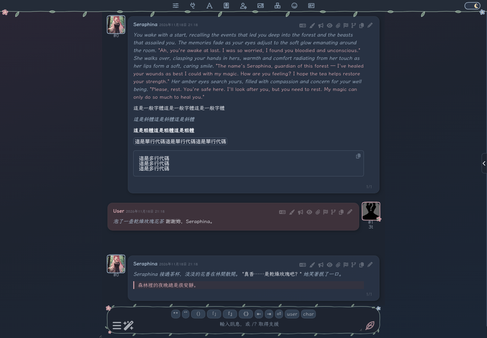

[English](README.md) · [繁體中文](README.zh-TW.md) · [简体中文](README.zh-CN.md)

# Dried Petal Tea

**A hand-drawn SillyTavern theme in dried rose and misty blue**

<table>
  <tr>
    <th>Day</th>
    <th>Night (Midnight Blueberry)</th>
  </tr>
  <tr>
    <td></td>
    <td></td>
  </tr>
</table>

## Features

- Oat-white background with dried rose pink and misty blue; night mode switches to a midnight blueberry palette.
- Hand-drawn details: vine borders on the input box and under the top bar, hand-drawn top bar icons, flower slider thumbs, wobbly checkboxes, a leaf send button and sketched avatar frames.
- Favorite characters get a little flower before their name, which appears as soon as you favorite them.
- The loading screen shows a flower wreath with the theme name.
- Petals burst from the center of the screen and drift down when SillyTavern opens.
- Petal jar: click ✿ on a message to keep a line you like (select text first to keep just that part), and the jar shows a line of the day. It is just a fun quote collection and does not link back to the original message. Requires Theme Script.
- On first use the theme sets the chat style to Flat and turns on expanded message actions. You can change them back afterwards, and they are restored when you remove the theme. Requires Theme Script.
- Uses the Chienchia font, with LXGW WenKai filling in missing characters.
- Looks the same with or without Moonlit Echoes.

## Installation

1. Download [`Dried Petal Tea - Auto-Update.json`](Dried%20Petal%20Tea%20-%20Auto-Update.json) (open it and click the download button at the top right).
2. In SillyTavern **User Settings**, click **Import** next to **Theme**.
3. For the day/night switch, install [Theme Script](https://github.com/iiimabbie/ST-ThemeScript) and approve the script the first time it loads. The switch appears at the top right of the top bar.

> [!NOTE]
> Without Theme Script the theme always shows day mode; everything else still works.
