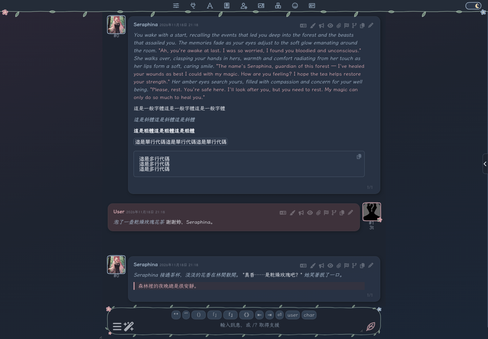

[English](README.md) · [繁體中文](README.zh-TW.md) · [简体中文](README.zh-CN.md)

# Dried Petal Tea

**干燥玫瑰与雾霾蓝的手绘风 SillyTavern 主题**

<table>
  <tr>
    <th>白天</th>
    <th>黑夜（深夜蓝莓）</th>
  </tr>
  <tr>
    <td></td>
    <td></td>
  </tr>
</table>

## 特色

- 燕麦白底配干燥玫瑰粉和雾霾蓝；黑夜模式换成深夜蓝莓配色。
- 手绘细节：藤蔓输入框和顶栏底线、手绘顶栏图标、小花滑块、歪歪的复选框、叶子发送键、头像手绘框。
- 收藏角色的名字前有一朵小花，点收藏时马上出现。
- 加载画面换成花叶花环和主题名称。
- 首页的最近聊天放在下面，排成手机聊天列表。
- 进入酒馆时，花瓣从画面中央炸开再飘落。
- 花瓣罐：点消息上的 ✿ 把喜欢的句子收进罐子（先选中就只收那一段），罐子里每天抽一句。纯粹收集名言好玩用，没有跳回原消息的功能。需要 Theme Script。
- 第一次应用时，会把聊天样式设成扁平、展开消息按钮打开；之后可以自己改回来，移除主题时会还原。需要 Theme Script。
- 字体用蒹葭楷（Chienchia），缺字由霞鹜文楷补上。
- 装不装 Moonlit Echoes 都能用，布局会一致。

## 安装

1. 下载 [`Dried Petal Tea - Auto-Update.json`](Dried%20Petal%20Tea%20-%20Auto-Update.json)（打开后点右上角的下载按钮）。
2. 在 SillyTavern 的**用户设置**中，点击**主题**旁的**导入**。
3. 想要日夜切换的话，安装 [Theme Script](https://github.com/iiimabbie/ST-ThemeScript)，第一次加载时同意运行脚本。切换开关会出现在顶栏右上角。

> [!NOTE]
> 没有安装 Theme Script 时固定显示白天模式，其他样式照常。
