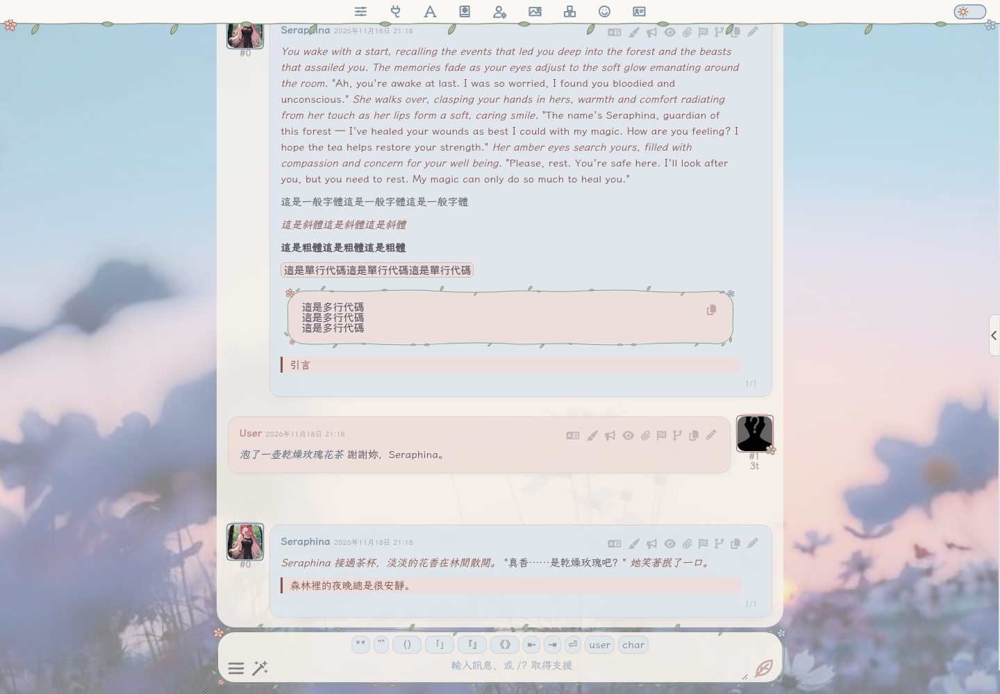
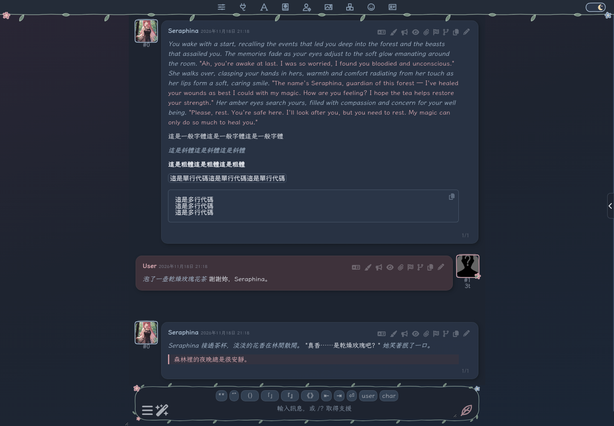

[English](README.md) · [繁體中文](README.zh-TW.md) · [简体中文](README.zh-CN.md)

# Dried Petal Tea

**乾燥玫瑰與霧霾藍的手繪風 SillyTavern 主題**

<table>
  <tr>
    <th>白天</th>
    <th>黑夜（深夜藍莓）</th>
  </tr>
  <tr>
    <td></td>
    <td></td>
  </tr>
</table>

## 特色

- 燕麥白底配乾燥玫瑰粉和霧霾藍；黑夜模式換成深夜藍莓配色。
- 手繪細節：藤蔓輸入框和頂欄底線、手繪頂欄圖示、小花拉條、歪歪的勾選框、葉子送出鍵、頭像手繪框。
- 我的最愛角色名字前有一朵小花，按最愛時馬上出現。
- 載入畫面換成花葉花圈和主題名稱。
- 首頁的最近聊天放在下面，排成手機聊天列表。
- 進入酒館時，花瓣從畫面中央爆開再飄落。
- 花瓣罐：點訊息上的 ✿ 把喜歡的句子收進罐子（先反白就只收那一段），罐子裡每天抽一句。純粹收集名言好玩用，沒有跳回原訊息的功能。需要 Theme Script。
- 第一次套用時，會把聊天樣式設成扁平、展開訊息按鈕打開；之後可以自己改回來，拿掉主題時會還原。需要 Theme Script。
- 字型用蒹葭楷（Chienchia），缺字由霞鶩文楷補上。
- 有沒有裝 Moonlit Echoes 都能用，版面會一致。

## 安裝

1. 下載 [`Dried Petal Tea - Auto-Update.json`](Dried%20Petal%20Tea%20-%20Auto-Update.json)（打開後點右上角的下載按鈕）。
2. 在 SillyTavern 的**使用者設定**中，點選**主題**旁的**匯入**。
3. 想要日夜切換的話，安裝 [Theme Script](https://github.com/iiimabbie/ST-ThemeScript)，第一次載入時同意執行腳本。切換開關會出現在頂欄右上角。

> [!NOTE]
> 沒有安裝 Theme Script 時固定顯示白天模式，其他樣式照常。
